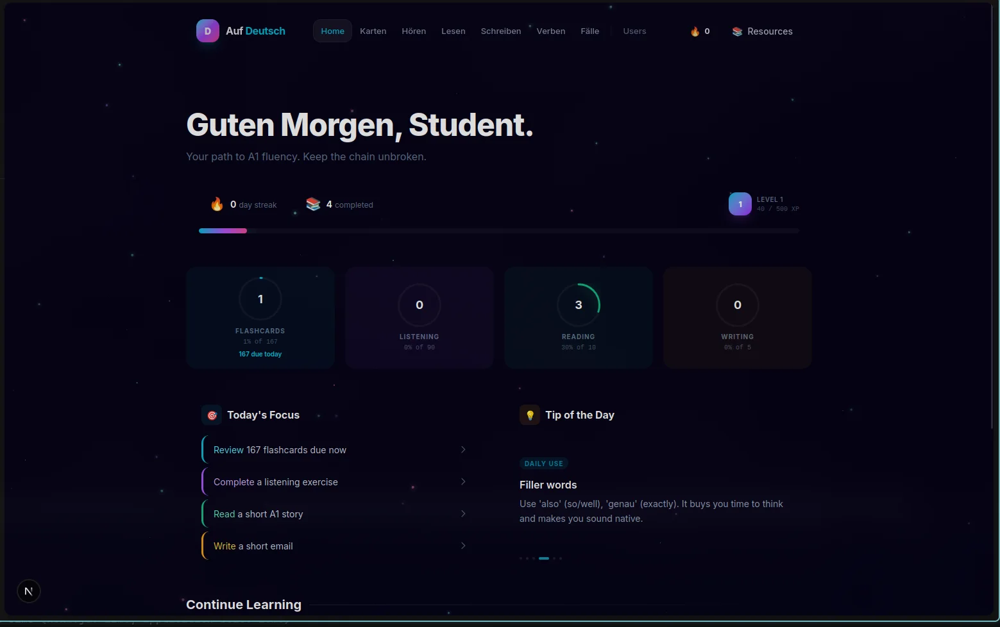
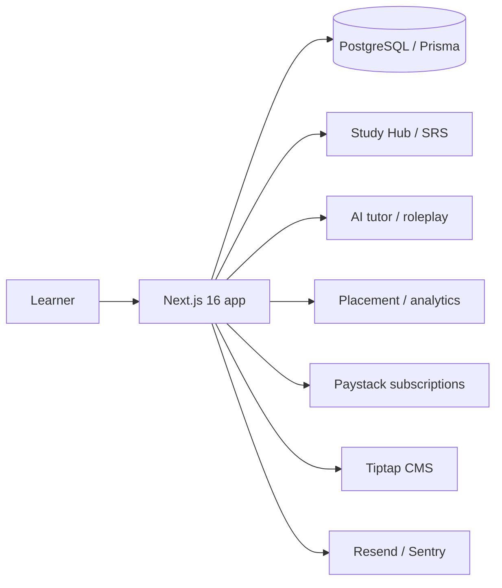

# Auf Deutsch

**A live German A1 study platform, not a mockup.**

[Live product](https://auf-deutsch.vercel.app/) · [Portfolio case study](https://augustine-portfolio-two.vercel.app/2d) · [All case studies](README.md)

## Problem

Most language apps optimize for streaks and notifications. Auf Deutsch was built around a study-first loop: learn a concept, practice it, review it at the right interval, and see what to do next.

It is a live product with a database-backed Study Hub, spaced repetition, AI tutoring, placement, analytics, and a working subscription path.

## Role

Sole architect and engineer. Live beta.

## Architecture

## Product and security properties

- **Study loop.** Six learn modules, practice trainers, SRS flashcards, placement tests, XP, streaks, and a global leaderboard.
- **AI surfaces.** Streaming tutor, roleplay scenarios, writing feedback, and explainers through OpenAI and Groq.
- **Operational surface.** Paystack subscriptions, promo codes, Resend email, Sentry, GDPR export/delete, and PWA support.
- **Content operations.** Tiptap CMS, Recharts analytics, and Framer Motion.
- **Privacy.** Account export and deletion paths are part of the product, not an afterthought.

## Evidence

- Live production URL
- 6 learning modules
- SRS review loop
- AI tutor and roleplay
- Subscription and GDPR flows

## What is not public

Source code, user data, model prompts, payment configuration, and content drafts.

## What I would test next

- Retention and learning-outcome metrics beyond streaks.
- Accessibility pass across the study and review flows.
- More A1 content and a clearer placement-to-module path.
- Cost and latency budgets for the AI tutor.
