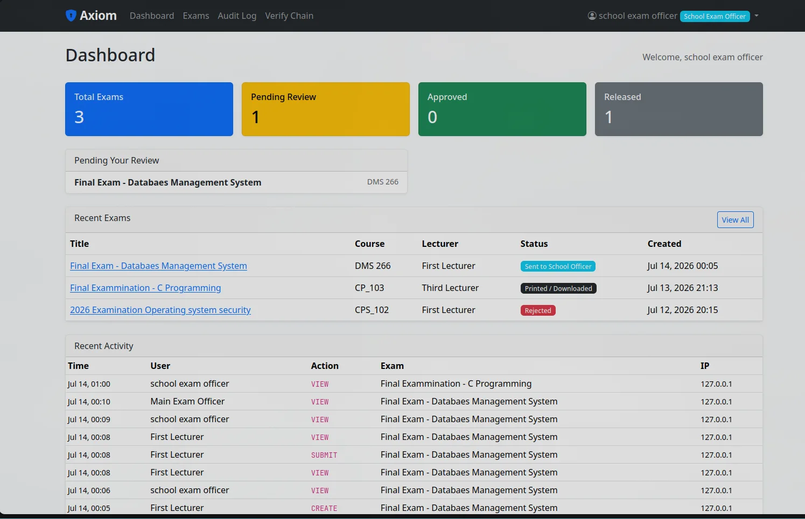
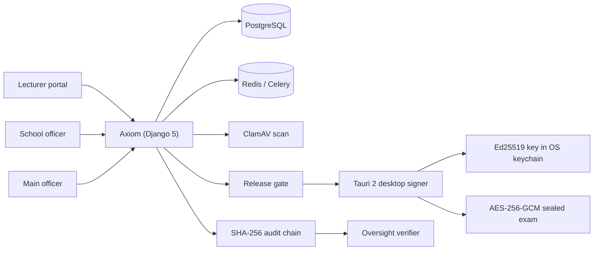

# Axiom

**Zero-trust exam routing with an audit trail you can verify.**

[Portfolio case study](https://augustine-portfolio-two.vercel.app/2d) · [Architecture brief](https://share.note.sx/qh85nncb#oHXnEuoqaRxlc234Ov6GSl3njLhKkyhTlUvaD6eNrdU) · [All case studies](README.md)

## Problem

Exam material moves through lecturers, school officers, main officers, signers, and audit. Every handoff is a chance for leakage, substitution, or a release that quietly bypasses policy. Most workflows can tell you who clicked a button. Very few can prove that the released file is the file that was approved, or that the audit log was not edited afterward.

Axiom routes the full exam lifecycle through five stages and makes release fail closed.

## Role

Sole architect and engineer. Private beta, hardening.

## Architecture

The server can request a signature. It cannot export the signing key.

## Security model

- **Tenant isolation at the ORM layer.** Every query is scoped; isolation is not left to view-level checks.
- **Five lifecycle stages with fail-closed gates.** A release cannot skip the signer or the audit stage.
- **Per-exam encryption.** Each exam is sealed with AES-256-GCM; keys are not stored next to the ciphertext.
- **Separate signer trust boundary.** The Ed25519 key lives in the OS keychain behind a Tauri 2/Rust desktop signer with a Next.js/React UI.
- **Tamper-evident audit ledger.** Every action is hash-chained; an independent verifier can recompute the chain.
- **Identity and hygiene.** OAuth 2.0/PKCE SSO, TOTP MFA, ClamAV scanning, quotas, storage lifecycle, and encrypted backups.

## Evidence

- 68k lines of code
- 40 user-facing features
- 22 test files
- 5 lifecycle stages
- Independent audit-chain verification in [Oversight](oversight.md)
- Architecture brief linked above

## What is not public

Source code, tenant data, deployment configuration, signing keys, and live exam material.

## What I would test next

- Release-gate bypass attempts across every role and stage transition.
- Key rotation and recovery without breaking the audit chain.
- Restore drills that verify both the database and the sealed exam objects.
- External review of the signer boundary and key-custody model.
