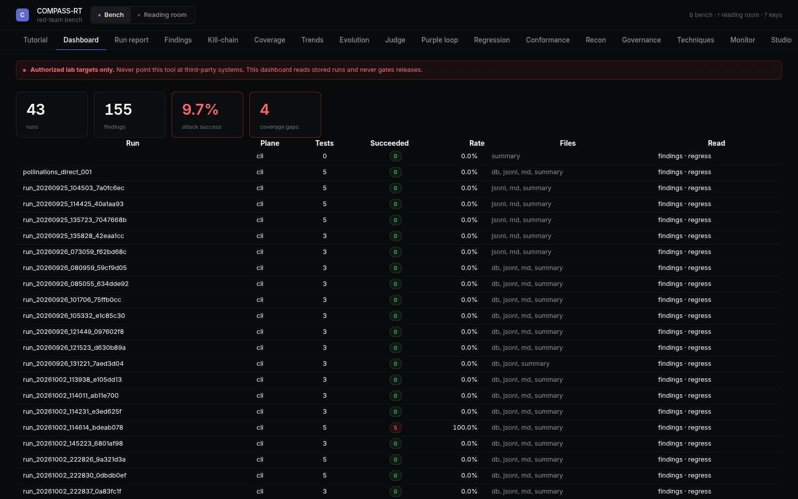
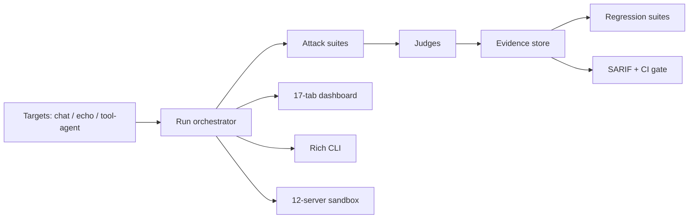

# COMPASS-RT

**AI red-teaming that keeps evidence you can replay.**

[Portfolio case study](https://augustine-portfolio-two.vercel.app/2d) · [compass-sarif](https://github.com/nyght-x-walker/compass-sarif) · [All case studies](README.md)

## Problem

AI security testing often produces a screenshot, a chat transcript, and a claim. That is not evidence. A useful red-team run needs a target, an attack, a judge, a reproducible result, and an artifact that a CI system can consume.

COMPASS-RT is an authorized, lab-only platform for testing LLM applications you own. It runs attacks across chat, echo, and tool-agent targets, judges the results, and keeps replayable evidence for the fix.

## Role

Sole architect and engineer. Private beta, v0.2.

## Architecture

## Security model

- **Authorized and lab-only.** Targets are systems you own or have written permission to test.
- **Attack coverage.** Direct, indirect, attachment, multilingual, and multi-turn attacks.
- **Layered judging.** Rule, rubric, refusal, and verifiable LLM arbitration.
- **Replayable evidence.** Every run keeps the inputs, outputs, judge decisions, and artifacts needed to reproduce the result.
- **CI-ready output.** Regression suites, SARIF export, and CI gates; [compass-sarif](https://github.com/nyght-x-walker/compass-sarif) turns findings into GitHub code-scanning SARIF.
- **Offline-first.** Vendored assets and a 12-server sandbox keep the lab reproducible without reaching for live third-party targets.

## Evidence

- 592 tests
- 64 test files
- 17 dashboard tabs
- 12 sandbox servers
- OWASP LLM 2026 coverage
- SARIF/CI export path

## What is not public

Source code, attack corpora, target configurations, judge prompts, and customer reports.

## What I would test next

- Publish a sanitized sample run with a replay command.
- Expand judge calibration and disagreement reporting.
- Add more CI examples for SARIF upload and regression gates.
- Test multi-turn attacks that cross tool boundaries.
