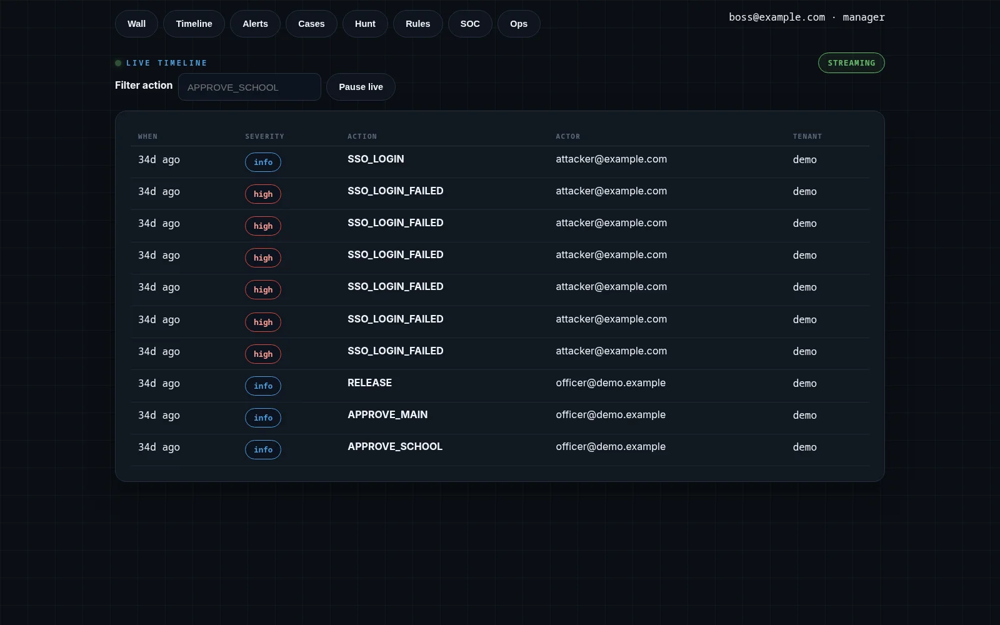
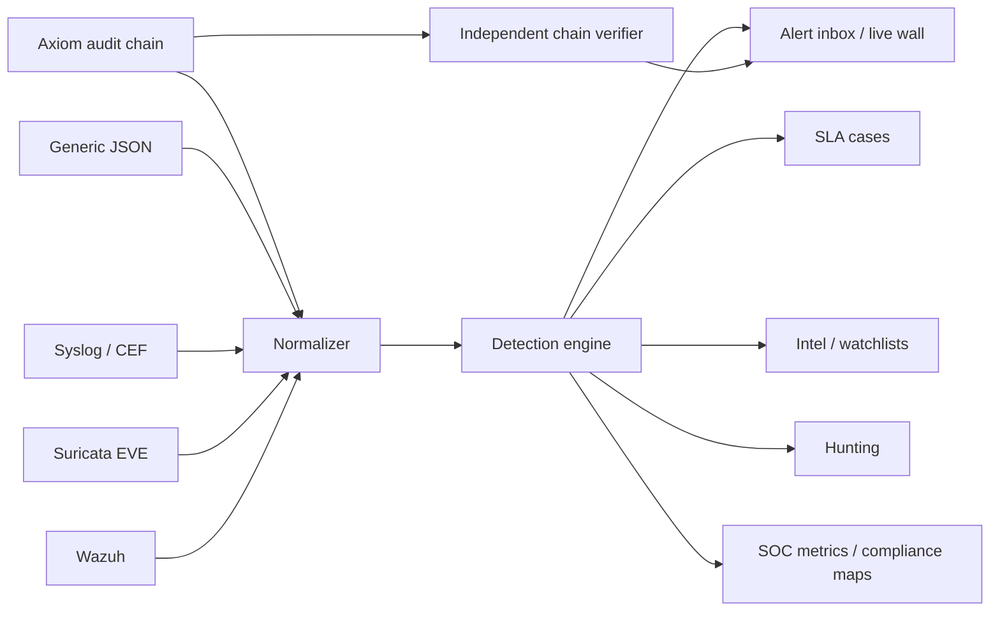

# Oversight

**A SOC workspace that checks the audit log instead of trusting it.**

[Portfolio case study](https://augustine-portfolio-two.vercel.app/2d) · [Axiom case study](axiom.md) · [All case studies](README.md)

## Problem

A SIEM is only useful if it can answer two questions: what happened, and can I trust the record? Most dashboards stop at the first question. Oversight was built around the second.

It normalizes noisy sources, runs MITRE-tagged detections, and independently recomputes Axiom's hash-chained audit log to surface forged links, sequence gaps, and stalled writers.

## Role

Sole architect and engineer. Private beta, v1.0.

## Architecture

## Security model

- **Multi-tenant workspace.** JWT sessions, Redis, Alembic migrations, and tenant-scoped queries.
- **Six event sources.** Axiom, generic JSON, syslog, CEF, Suricata EVE, and Wazuh normalize into one stream.
- **Detection coverage.** Count, distinct, watchlist, and sequence rules tagged to MITRE ATT&CK.
- **Independent verification.** Oversight recomputes Axiom's chain rather than accepting the writer's word; it flags forged links, sequence gaps, and stalled writers.
- **Analyst workflow.** Alert inbox, live wall, SLA cases, intel, watchlists, hunting, SOC metrics, compliance maps, and allowlisted playbooks.
- **Live transport.** Server-sent events stream new events to the React 19/TypeScript UI.

## Evidence

- 58 tests
- 8 test files
- 4 alert states
- 6 event sources
- Independent Axiom audit-chain verification
- Screenshot of a seeded demo tenant

## What is not public

Source code, tenant telemetry, detection content, playbooks, and customer data.

## What I would test next

- Detection-as-code regression tests for every rule.
- More source parsers and schema drift handling.
- Alert-quality metrics: false-positive rate, time-to-triage, and case closure time.
- A replay harness for chain-gap and stalled-writer scenarios.
